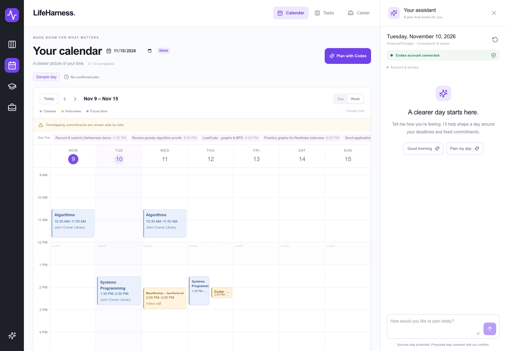

# LifeHarness

A calendar-first workspace for classes, coursework and career preparation. **See
your schedule and talk to Codex side by side, then confirm the plan on the page.**



## Start

Requires Node.js 22+, npm and Codex CLI **0.160.0+** signed in with ChatGPT on this
computer. [Install Codex](https://developers.openai.com/codex/cli/) and use
`codex login` once if necessary. The app uses that locally signed-in account's Codex
allowance. It does not call this README/chat, attach to your existing conversation,
or promise that all ChatGPT products share the same usage pool. API-key accounts
are rejected by the browser bridge; no API key is stored or requested.

```sh
npm install
npm run dev
```

Open http://127.0.0.1:3000 and click **Open calendar**. Your weekly schedule and
planning assistant are visible together. **Tasks** retains your task board.
Everything after starting the local app happens in the browser:

1. Choose today or **Sample day** (November 10, 2026).
2. Click **Good morning** / **Plan my day**, or type a message.
3. Answer the questions. Codex uses the selected date, coursework, job data,
   existing progress, confirmed history and cross-day notes.
4. Review priorities and notes in the panel. The calendar previews proposed focus
   blocks with dashed outlines marked **Draft · not saved**.
5. Ask for changes or click **Don't save**. To persist the displayed version,
   click **Confirm & save**. Typing “yes” alone does not write files.
6. The calendar updates immediately after saving and polls every three seconds
   for other changes. Keep the assistant open while navigating the calendar.

Opening the chat checks local login without running a model. Sending messages
uses Codex allowance; saving/discarding needs no model call. Closing and reopening
restores the in-memory conversation while the server remains running (90-minute
idle limit). A server restart clears drafts/chat, but saved plans/notes remain.
The bridge preserves the configured model. Credentials never go to the browser.

## Calendar and task features

- Calendar opens by default with all seven days, fixed classes/interviews and saved
  task blocks. Day/Week, Today, previous/next and date controls navigate directly.
- Overlapping commitments appear side by side. Deadlines stay separate from actual
  scheduled time; unsaved drafts do not become confirmed events.
- Phones start with a readable Day view and stack the assistant below the calendar.
- In **Tasks**, drag cards or use the status menu: To do, In progress, Done.
- Search, filter academic/career work and find upcoming deadlines.
- Open task context and run a pausable 25-minute focus timer.
- The calendar is always visible beside desktop chat; Career shows applications.
- Task updates persist in data/user; timer state stays in localStorage. Latest
  manual/confirmed completion wins. Both original source datasets remain read only.

## How browser planning works

The local Next.js server connects to native **Codex app-server over private stdio**,
checks that authentication is ChatGPT (not an API key), and creates an independent,
ephemeral read-only thread. Shell execution, MCP, plugins, subagents and web search
are disabled. The client denies interactive tool requests. Validated snapshots and
the morning skill/reference rules supply context; the AI only returns a structured
message/proposal. It cannot save, run an application or change source data.

Server-held drafts have opaque IDs. New messages invalidate the previous draft;
stale confirmations fail. The server validates schema, source IDs, exact fixed
events, Chicago dates, task hours, lunch, links and paths before preview and saving.
Confirmation adds the actual server timestamp and atomically writes the dated plan,
then notes. A notes failure is explicitly reported as partial success. Duplicate
confirmation retries do not rewrite an already saved version. No arbitrary JSON,
file path or process arguments are accepted from the browser.

Mutation endpoints require same-origin loopback requests, bounded JSON and strict
action schemas. Sessions use HttpOnly SameSite cookies and bounded local memory.
The app is intended for localhost, with no deployment, app login or database.

## Files and checks

| Location                         | Purpose                                                          |
| -------------------------------- | ---------------------------------------------------------------- |
| data/sources/                    | Protected synthetic coursework/career data, November 9–15, 2026. |
| data/generated/                  | Local gitignored confirmed plans and cross-day memory.           |
| data/user/                       | Local gitignored human task progress.                            |
| .agents/skills/morning-check-in/ | Reusable morning planning workflow.                              |
| context/                         | Preferences and output contract.                                 |
| src/lib/codex-bridge.ts          | Guarded native app-server protocol, ChatGPT account check.       |
| src/lib/web-planner.ts           | Validated drafts, refusal/revision and explicit persistence.     |
| .codex/, scripts/planner.mjs     | Optional terminal harness and its native protection hooks.       |

```sh
npm run check             # Types, unit/security tests, production build
npm run test:e2e          # Board + browser planner UI regression tests
npm run test:browser:live # Optional actual Codex flow in a disposable fixture
npm run test:safety       # Deterministic native-hook process test
npm run format:check
```

The live check uses your account allowance and never saves to your real generated
folder. Browser regression model replies are mocked; actual model evidence is
recorded separately. Playwright needs Chromium (`npx playwright install chromium`)
or `PLAYWRIGHT_CHROMIUM_EXECUTABLE` pointing to a testing browser.

The earlier terminal harness remains optional: `npm run planner` / `planner:demo`.
Its native hooks require review/trust in `/hooks`; browser planning does not require
a separate interactive Codex terminal. The two modes have different enforcement:
terminal mode constrains helper writes, browser mode forbids AI writes and uses
an explicit guarded confirmation endpoint.

## Troubleshooting

- **Connection needs attention:** install Codex and sign in with ChatGPT once on
  this computer; click **Check connection again**. API-key billing is disabled.
- **Generation fails or allowance exhausted:** the page shows the failure, keeps
  your input and does not pretend to answer or save. Check local Codex connectivity
  and account availability, then retry. Requests time out after 90 seconds.
- **Invalid proposal:** no draft is saved; ask for a corrected schedule. Fixed
  conflicts must remain visible. Sources must both be valid before planning.
- **No saved plan:** match the selected date, then use **Confirm & save**.
- **Stale draft:** review the newest proposal. A revision invalidates older IDs.
- **Server restarted:** start a new conversation. Previously saved plans remain.

See [current evidence](docs/verification.md), [architecture](docs/architecture.md)
and the [English demo script](docs/demo.md). This Codex adaptation was requested
by the owner; the original assignment names Claude Code, so product-specific
compliance is not claimed. Historical reports are under docs/archive.
