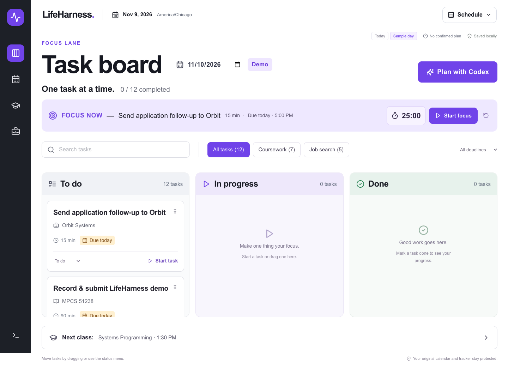

# LifeHarness

A daily task board for classes, coursework and career preparation. Codex runs the
morning conversation in your terminal; the dashboard displays your confirmed plan.



## Start

Requires Node.js 22+, npm, and Codex CLI **0.160.0+** with a working login.
Install Codex using the [official CLI guide](https://developers.openai.com/codex/cli/),
then run `codex login`. The installed CLI can use your ChatGPT login; this project
has no model API server or stored API key. Model usage uses your Codex account.

```sh
npm install
npm run dev
```

Open http://127.0.0.1:3000 for the title page and `/board` for the board.
In a second terminal, from this repository:

```sh
npm run planner:demo
```

The demo selects November 10, 2026. Select the same date on the board. For today,
use `npm run planner`; for another day use `npm run planner -- --date YYYY-MM-DD`.
Review the authored project hooks through Codex `/hooks` before the first planning
conversation. Say **Good morning** or **Plan my day**, answer the questions, review
the proposed schedule, then explicitly confirm. Refusing or revising a proposal
must leave plans and notes unchanged. After a successful save, the board polls
every 3 seconds. The planner keeps your selected model.

## Using the board

- Move tasks between To do, In progress and Done by dragging or using the status menu.
- Search tasks; filter academic/career work and upcoming deadlines.
- Open a task for context or start a persistent, pausable 25-minute focus timer.
- Open Schedule for fixed events and the confirmed plan; open Career for applications.
- Plan with Codex copies the date-specific terminal command. It does not start a model
  in the browser. The terminal shows the actual agent and tool activity.

Human task changes use a same-origin validated API and stay in `data/user/task-state.json`.
Codex reads this progress but cannot edit it. Generated plans, notes and task progress
are local and gitignored. Newer explicit changes take precedence over older completion
records. The source JSON remains read only to both application and planning sessions.

## Harness

| File                                       | Purpose                                                         |
| ------------------------------------------ | --------------------------------------------------------------- |
| `AGENTS.md`                                | Short standing rules; also explicitly supplied by the launcher. |
| `.agents/skills/morning-check-in/SKILL.md` | Native Codex skill, selected from a morning/planning request.   |
| `.codex/config.toml`                       | Safe read-only default for an ordinary Codex launch.            |
| `.codex/hooks.json`                        | Native PreToolUse protection and fresh prompt-time clock.       |
| `context/`                                 | Planning preferences and output format, loaded when needed.     |
| `data/sources/`                            | Two synthetic academic and job datasets, November 9–15, 2026.   |
| `data/generated/`                          | Confirmed dated plans and cross-day notes.                      |
| `scripts/planner-files.mjs`                | Curated reads and schema-validated atomic JSON writes.          |

The supported launcher starts Codex with `data/generated` as its working directory,
workspace-write sandbox, no extra writable roots, no command network, no escalation,
and verified disabled MCP servers, disabled plugin defaults and hook restrictions. It first checks that the OS sandbox blocks
write-open of a protected source, aborting if this check fails. Hooks allow narrowly
parsed read commands and validated writes through the helper; arbitrary execution,
patching and other tool types are denied. Review hook definitions before trusting them.
Normal launches never bypass hook trust. On unsupported sandbox platforms, the
launcher fails rather than silently dropping source protection.

Codex chooses questions and priorities and interprets your confirmation. Code validates
paths, JSON schemas, references, fixed events, lunch and task hours. Neither the helper
nor the OS sandbox independently proves human agreement. Without trusted hooks,
sandbox protection still limits writes to generated output, but schema and tool policy
coverage is reduced: trust the hooks before planning. These restrictions apply to the
supported launcher, not to your independent development terminal.

## Verify

```sh
npm run check          # TypeScript, unit/security tests, production build
npm run test:safety    # Actual hook process; simulated malicious tool payload
npm run test:e2e       # Desktop/mobile board and refresh regression checks
npm run test:hook:live # Optional real Codex integration in an isolated fixture
npm run planner -- --check # Inspect launch policy without running a model
```

The live test uses your Codex account. Its isolated, inspected hooks can use the CLI's
hook-trust automation flag; the normal launcher does not. Browser tests require
Playwright Chromium (`npx playwright install chromium`), or set
`PLAYWRIGHT_CHROMIUM_EXECUTABLE` to an installed testing browser.
See [verification](docs/verification.md), [architecture](docs/architecture.md),
[demo script](docs/demo.md) and [assignment audit](docs/assignment-audit.md).

## Troubleshooting

- **No plan:** choose matching dates in terminal and board, then confirm a proposal.
  Today's date is the default; the sample week needs explicit demo mode.
- **Codex does not start:** check `codex --version` and `codex login status`.
  If the sandbox probe fails, use a supported local OS sandbox; do not bypass it.
- **Tool denied:** inspect `/hooks`. Use only the helper commands in the morning
  skill. Ask Codex to fix an invalid plan and confirm again before saving.
- **Source missing / bad JSON / refresh error:** the board shows the error and keeps
  any last good client data marked stale. Restore files in your development terminal.
- **Hook changes:** review/trust the changed definition again through `/hooks`.

This is a Codex-only adaptation, explicitly chosen by the owner. The original assignment
names Claude Code; this version does **not** claim to meet that product-specific requirement.
Earlier Claude evidence is retained under `docs/archive/` as history, not Codex evidence.
Recording and classroom submissions are performed by the student. No deployment is required.
